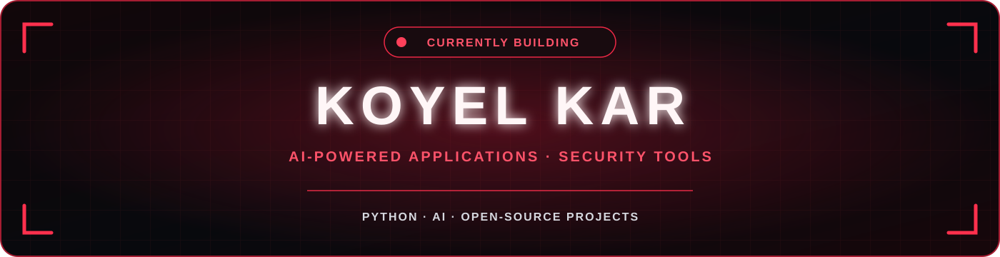

<h2 align="center">🌐 Socials:</h2>

     

---

<h2 align="center">💫 About Me:</h2>

🔭 I'm currently building **AI-powered applications** and **security tools** 
👯 I'm looking to collaborate on **Python, AI, and open-source projects** 
🤝 I'm looking for help with **production-grade AI deployments** 
🌱 I'm currently learning **applied LLMs, system design, and cloud deployment** 
💬 Ask me about **Python, Streamlit, Flask, and practical security projects** 
⚡ Fun fact: **I built an app that summarizes long videos so you don't have to watch them.**

---

<h2 align="center">💻 Tech Stack:</h2>

            

---

<h2 align="center">🚀 Featured Projects</h2>

| Project | What it does | Built with |
| :--- | :--- | :--- |
| **[AI Video Summarizer](https://github.com/koyelkar24/summarization_dashboard)** | Turns a YouTube URL or uploaded video into a transcript, AI summary, smart chapters, and a chat-with-video study assistant. | Python · Streamlit · faster-whisper · Ollama / OpenAI |
| **[Password Analyzer](https://github.com/koyelkar24/passwordAnalyser)** | Scores password strength with zxcvbn and entropy checks, plus known-breach lookups. | Python · Flask · zxcvbn |
| **[QuantumCrypt](https://github.com/koyelkar24/text_encryption)** | A Streamlit playground for passphrase-based text encryption and Base64 encoding. | Python · Streamlit |

---

<h2 align="center">📊 GitHub Stats:</h2>

| | |
| :---: | :---: |
|  |  |
|  | |

---

<h2 align="center">📈 GitHub Summary</h2>

---

<h2 align="center">✍️ Dev Quote</h2>

